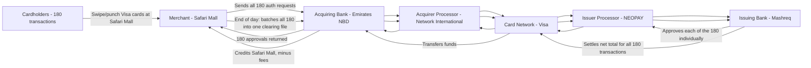
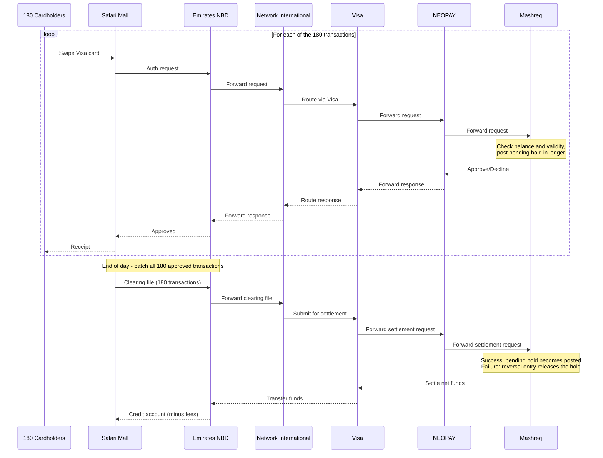

# Card Transaction Flow: 100 AED Visa Payment at Safari Mall

## Parties

| Role | Party |
|---|---|
| Cardholder | Al Mamun |
| Merchant | Safari Mall |
| Acquiring bank | Emirates NBD |
| Acquirer's processor | Network International |
| Card network | Visa |
| Issuer's processor | NEOPAY |
| Issuing bank | Mashreq |

## Flow Diagram (batch of 180 transactions)

## Sequence Diagram (batch of 180 transactions)

## Key Points

- **Authorization is real time.** Each transaction is approved individually, and the issuer immediately posts a pending hold (ledger entry) against the cardholder's available balance.
- **Clearing and settlement are batched.** Usually once a day, all approved transactions are bundled into a clearing file and settled as one net transfer between banks via Visa.
- **Pending becomes posted.** If settlement succeeds, the pending entry is flagged as posted. If it fails, the issuer posts a reversal entry that releases the hold.
- **Reversals are paired by reference ID.** The original debit and its reversal share a transaction or authorization ID, so the app can merge or hide the pair.
- **Running balance is calculated server-side.** Each ledger record stores its own "balance after transaction" value, and the mobile app only displays it.
